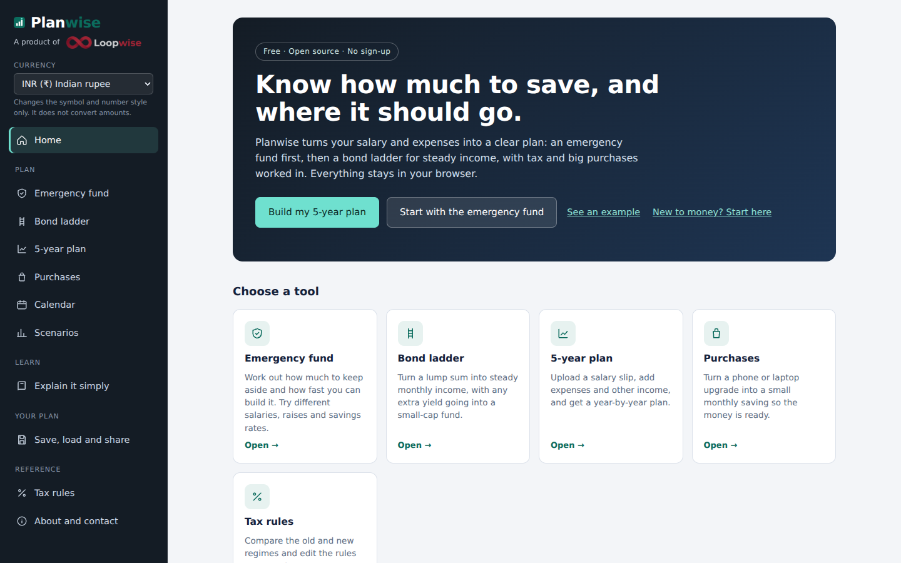
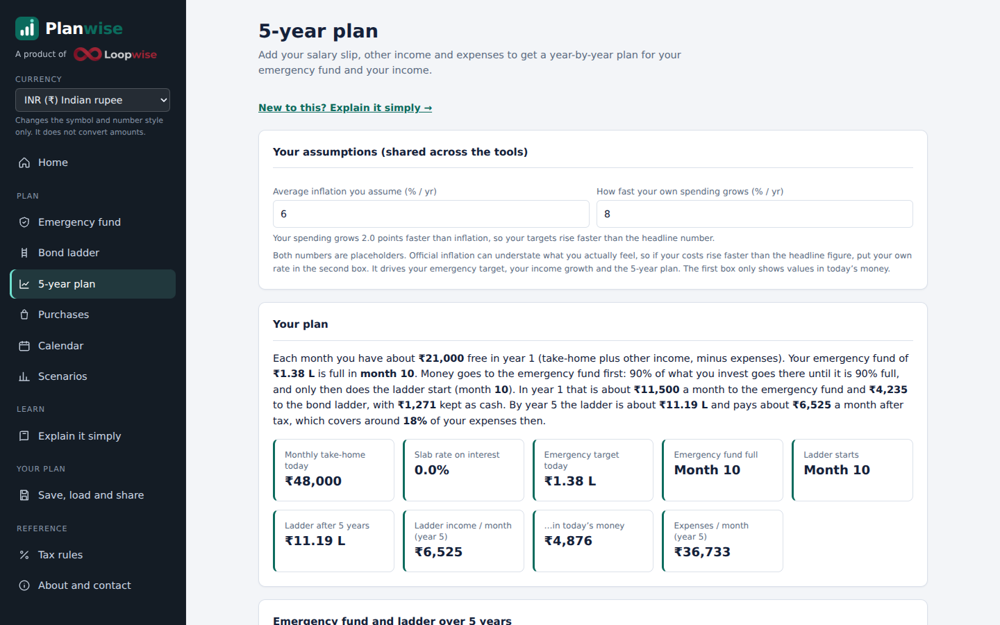
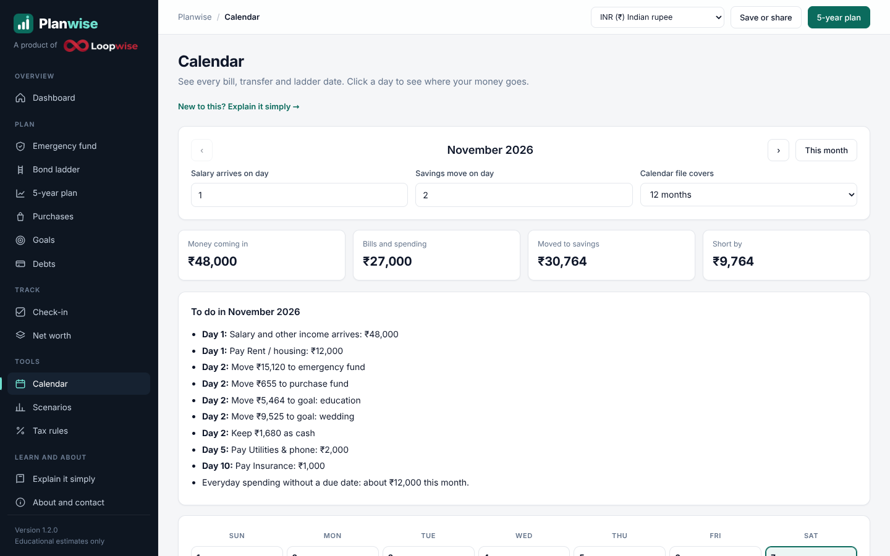
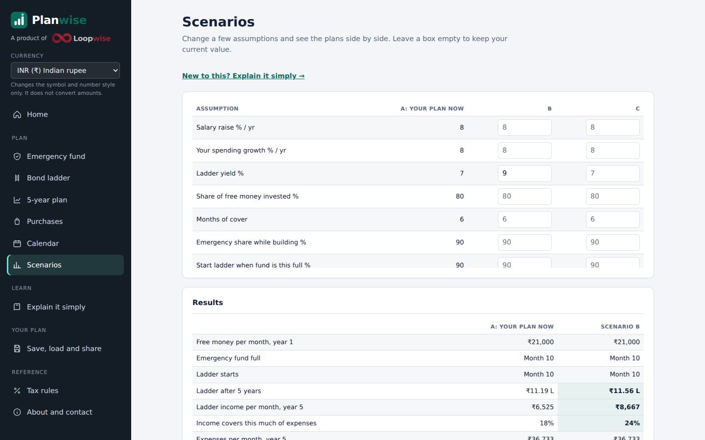
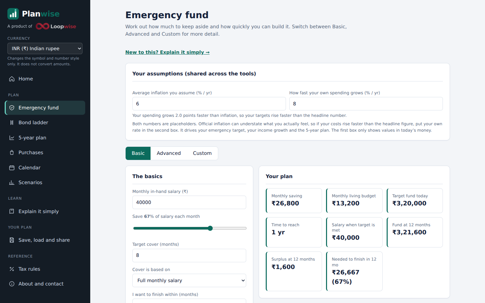
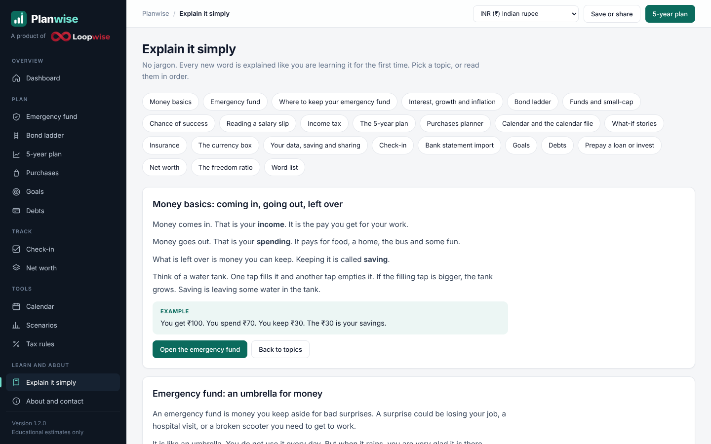

<p align="center">
  
</p>

<h1 align="center">Planwise</h1>

<p align="center"><b>Know how much to save, and where it should go.</b><br>
Plan your emergency fund, steady income and big purchases, in your browser.</p>

<p align="center">
  Free &middot; Open source &middot; No sign-up &middot; Private<br>
  <a href="https://chalkduggo.github.io/Planwise/"><b>Open Planwise</b></a> &middot;
  <a href="docs/Planwise-User-Guide.pdf">User Guide (PDF)</a> &middot;
  <a href="docs/planwise-demo.mp4">Demo video</a> &middot;
  <a href="docs/Planwise-Brochure.pdf">Brochure</a>
</p>

> Planwise is an open-source software product developed and maintained by LoopWise, created by Suman Mondal.

<p align="center">
  
</p>

## What is Planwise?

Planwise turns your salary and expenses into a clear plan. It follows one simple order, because the order matters:

1. **Know your numbers.** Pay, other income and costs. Planwise estimates your tax.
2. **Protect yourself first.** Build an emergency fund that covers several months of must-have costs.
3. **Create steady income.** Grow a bond ladder that pays you every month.
4. **Stay ready.** Plan for purchases, and test what happens if your income stops.

It is one self-contained web page. There is no sign-up, no server and no tracking.

> **Disclaimer.** Planwise gives educational estimates based on the numbers and assumptions you enter. It is not financial, tax or investment advice, and it does not hold or move any money. Returns, prices and tax rules can change. Please speak to a qualified professional before making financial decisions.

## Screenshots

| | |
|---|---|
| <br>**Home** | <br>**5-year plan** |
| <br>**Calendar** | <br>**Scenarios** |
| <br>**Emergency fund** | <br>**Explain it simply** |

## Features

| Tool | What it does |
|---|---|
| **Emergency fund** | Basic, Advanced and Custom (year-by-year salary path) calculators. Where-to-keep-it tiers. An insurance check. |
| **Bond ladder** | Monthly tranches, taxed interest, extra yield into a small-cap fund, and a chance-of-success simulation. |
| **5-year plan** | Reads a salary slip, adds other income and expenses, and builds a year-by-year plan with a stress test. |
| **Purchases** | Turns a future phone or laptop into a monthly saving, with prices rising each cycle. |
| **Calendar** | A month view of bills, transfers and ladder dates, with a calendar file (.ics) for reminders. |
| **Scenarios** | Compare what-if plans side by side. |
| **Tax rules** | India (old and new regime), United States, Germany, France, Spain, Italy and the Netherlands. Every rule is editable. |
| **Currency** | INR, USD, EUR, GBP, AED, SGD, CAD and AUD. Changes the symbol and number style only. It does not convert amounts. |
| **Explain it simply** | A plain-words guide to every topic, for people with no background. |
| **Save, load, share, print** | In your browser, as a file, as copied text, or as a share link. |

## Quick start

**Use it online.** Open the live page, then click **See an example** on the home page to see a finished plan in seconds.

**Run it on your computer.** Download `index.html` and open it in any modern browser. That is all.

**Host your own copy.** See [Host it with GitHub Pages](#host-it-with-github-pages).

## Documentation

- [User Guide (PDF)](docs/Planwise-User-Guide.pdf), also as [Markdown](docs/USER_GUIDE.md): a 19-page guide to every tool.
- [Demo video](docs/planwise-demo.mp4): a 1-minute captioned tour.
- [Brochure (PDF)](docs/Planwise-Brochure.pdf): a two-sided overview you can print or share.
- [Release guide](docs/RELEASE_GUIDE.md): how the maintainer publishes a release with GitHub Desktop.

## Privacy

Everything you type stays in your browser. Planwise has no accounts, no analytics and no server. A salary slip is read on your own device.

Two things load from the internet. Neither receives your data:

- the Inter font, from Google Fonts
- the pdf.js library, from cdnjs, only when you upload a PDF salary slip

If you want zero outside requests, download these files into the repository and point `index.html` at them.

## Tax rules

All tax figures come from one editable table in the **Tax rules** tab. The defaults were last checked in November 2026:

| Region | Source of defaults |
|---|---|
| United States | IRS tax year 2026 brackets and standard deductions (single, married filing jointly). Federal income tax only. |
| India | New and old regime slabs for FY 2025-26, reported as unchanged for TY 2026-27. |
| Germany, France, Spain, Italy, Netherlands | Published 2026 rates, simplified. Income tax only. |

These are approximations. Social security, local taxes, family adjustments and many credits are not included. Please check them against official sources and edit the table when rules change. See [CONTRIBUTING.md](CONTRIBUTING.md) for how to update the defaults.

## Host it with GitHub Pages

1. Open the repository **Settings**, then **Pages**.
2. Under **Build and deployment**, choose **Deploy from a branch**.
3. Pick the `main` branch and the `/ (root)` folder, then **Save**.
4. After a minute, your site is live at `https://Chalkduggo.github.io/planwise/`.

## Repository layout

```
index.html                 The whole Planwise application
README.md                  This file
docs/
  Planwise-User-Guide.pdf  User guide
  USER_GUIDE.md            User guide as Markdown
  Planwise-Brochure.pdf    Two-sided brochure
  planwise-demo.mp4        Demo video
  planwise-demo.gif        Short animated preview
  banner.png               Banner and social preview image
  screenshots/             Screenshots used in the guide
  RELEASE_GUIDE.md         How to publish a release
CONTRIBUTING.md            How to help
CHANGELOG.md               What changed in each version
```

## Frequently asked questions

**Is my data safe?** What you type stays in your browser. If you save a plan, it is stored in this browser only. A share link contains your numbers, so only send it to people you trust.

**Does the currency box convert money?** No. It changes the symbol and number style only. Type your amounts in the money you use.

**Can Planwise move my money or connect to my bank?** No. It only does calculations.

**Why do my numbers differ from another calculator?** Different tools make different assumptions about tax, returns and timing. Check the assumptions, and edit the tax rules if yours differ.

## Contributing

Issues and pull requests are welcome. Helpful areas include checking tax rules, translating the interface, and accessibility fixes. Please read [CONTRIBUTING.md](CONTRIBUTING.md) first.

## Roadmap

- Chance-of-success for the whole plan, not only the small-cap part
- Household mode with two incomes
- Bengali and Hindi translations
- Installable offline version
- Self-hosted font and PDF reader

## Contact & Maintainer

Planwise is an open-source software product developed and maintained by LoopWise, created by Suman Mondal.

For product enquiries, technical discussions, collaboration, feedback and professional communication:

- Official LoopWise contact: [suman.mondal.8@loopwise.pro](mailto:suman.mondal.8@loopwise.pro)
- Personal contact: [sumanmondaljobs2022@gmail.com](mailto:sumanmondaljobs2022@gmail.com)

## Licence

See the [LICENSE](LICENSE) file.

## Credits

- [pdf.js](https://mozilla.github.io/pdf.js/) (Apache-2.0) reads PDF salary slips.
- [Inter](https://rsms.me/inter/) (SIL Open Font License) is the typeface.
