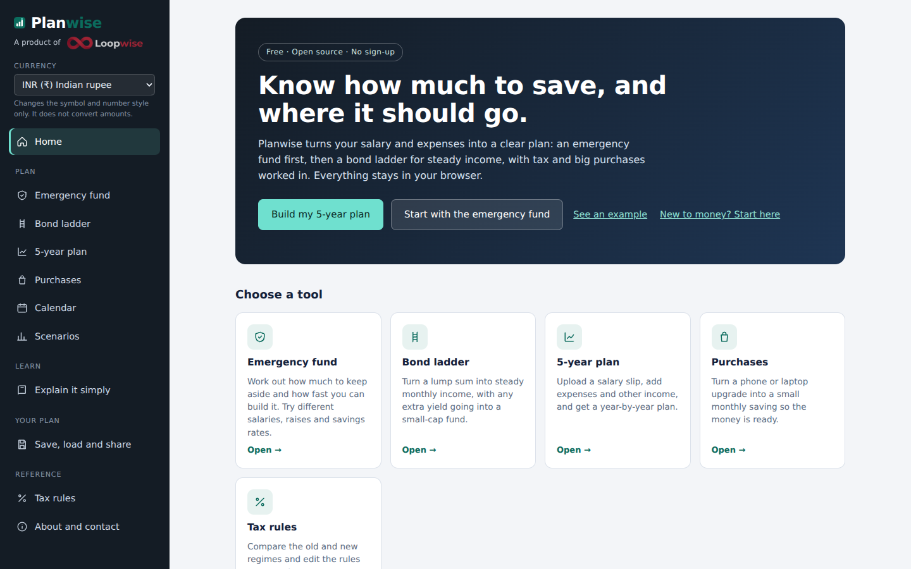
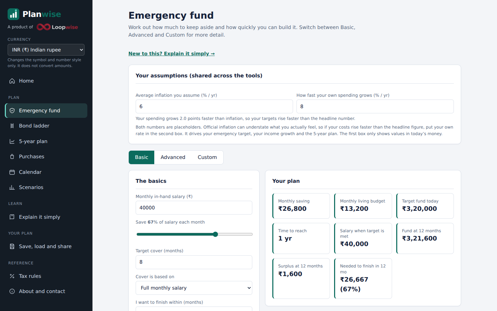
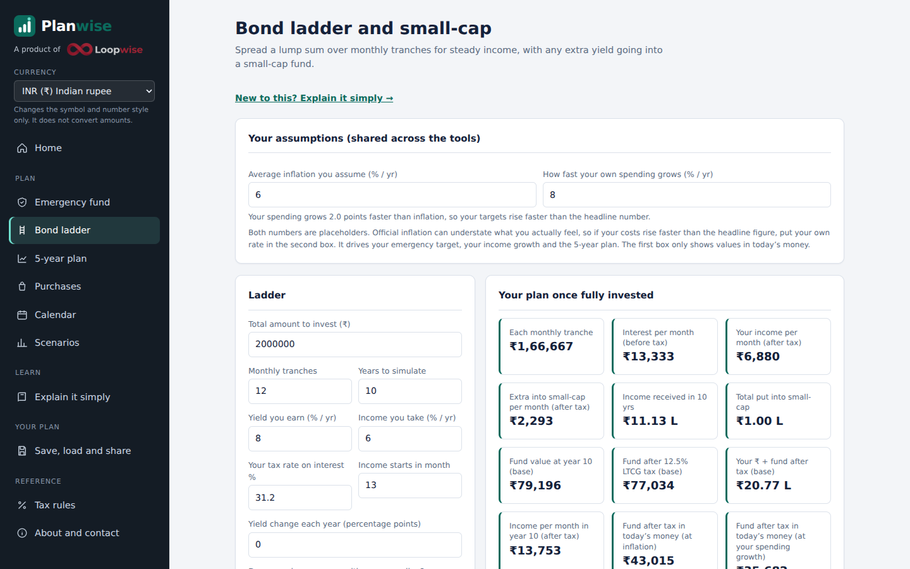
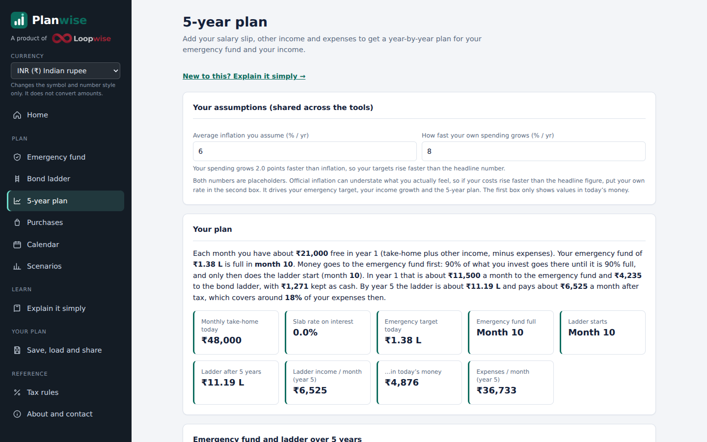
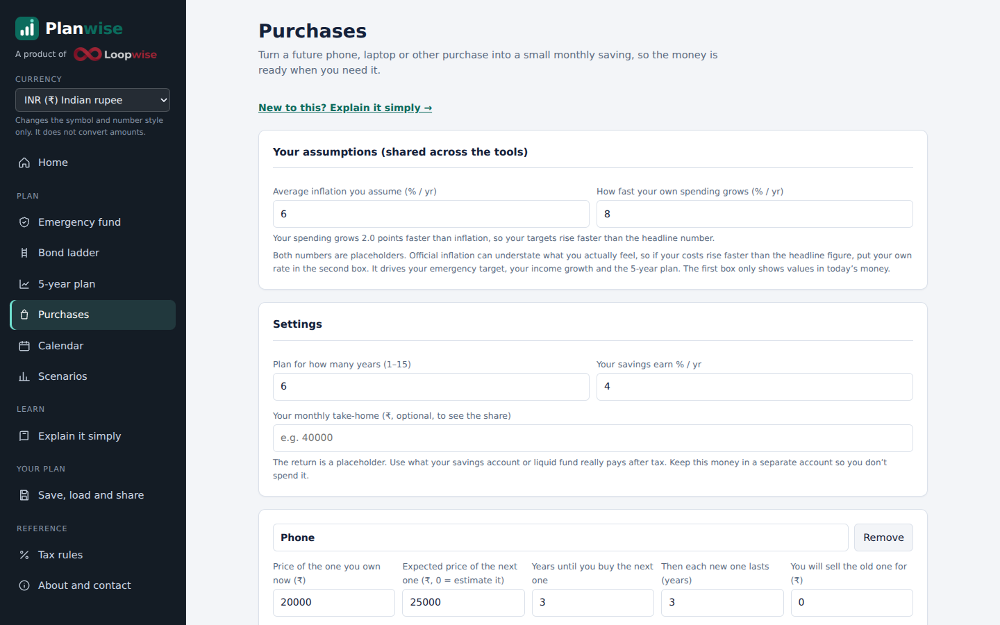
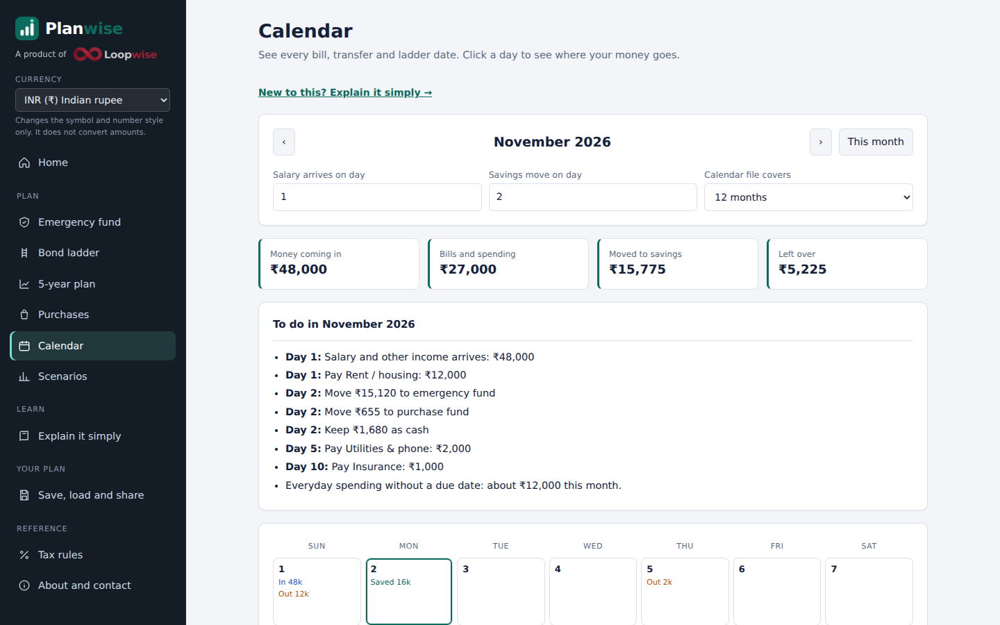
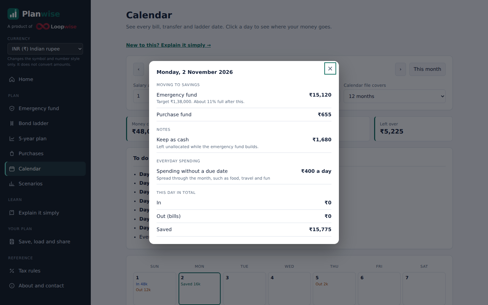
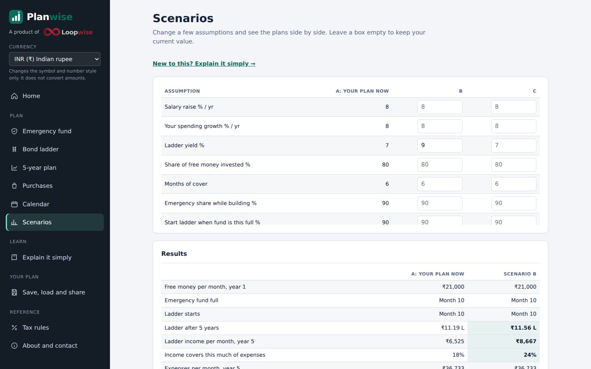
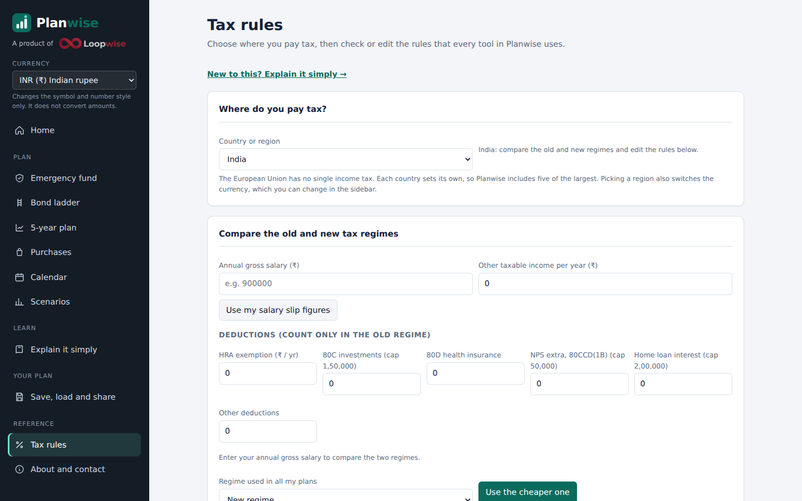

# Planwise User Guide

Planwise is an open-source software product developed and maintained by LoopWise, created by Suman Mondal.

A PDF version is in [Planwise-User-Guide.pdf](Planwise-User-Guide.pdf).

## Welcome to Planwise

Planwise helps you answer three questions. **How much should I keep aside for emergencies? How can my savings pay me a steady income? How do I plan for big purchases?** It turns your salary, expenses and goals into a clear, year-by-year plan.

It is free, open source and runs in your web browser. There is no sign-up and no server. What you type stays on your device.

### Who it is for

- People starting to save who want to know where to begin.
- People with a steady salary who want an emergency fund, steady income and fewer money worries.
- Anyone who wants to try “what if” questions about raises, yields and spending.

### What it is not

> Planwise gives educational estimates based on the numbers you type. It is **not** financial, tax or investment advice, and it does not move or hold any money. Returns, prices and tax rules can change. Please speak to a qualified professional before you decide.

*The home page and the sidebar.*

## Getting started

### Open Planwise

Open the page in any modern browser on a computer, tablet or phone. On a phone, tap the menu button at the top left to open the sidebar.

### The sidebar

- **Home**: the start page, with a “What to do this month” card once you have a plan.
- **Plan**: Emergency fund, Bond ladder, 5-year plan, Purchases, Calendar and Scenarios.
- **Learn**: “Explain it simply”, a plain-words guide to every topic.
- **Your plan**: save, load, share and print.
- **Reference**: Tax rules, and About and contact.
- **Currency**: sits at the top of the sidebar.

### Try an example in two minutes

1. On the home page, click **See an example**.
2. Planwise fills in sample pay and expenses and opens the 5-year plan.
3. Read the summary at the top. Then scroll to the chart, the year-by-year table and the stress test.
4. Open **Calendar** to see the same plan laid out day by day.

### Your own numbers

Start with the **5-year plan** if you have a salary slip. If you only want the emergency fund, open **Emergency fund** and try different savings rates.

## The big idea: do things in the right order

Planwise follows one simple order, because the order matters.

1. **Know your numbers.** Pay, other income and costs. Planwise estimates your tax.
2. **Protect yourself first.** Build an emergency fund that covers several months of must-have costs.
3. **Create steady income.** Grow a bond ladder that pays you every month.
4. **Stay ready.** Save for upgrades, and test what happens if your income stops.

> The 5-year plan puts about 90 of every 100 you invest into the emergency fund until it is 90% full. Then the ladder starts and gets the rest. When the emergency fund is full, everything goes to the ladder. You can change both 90s.

## Emergency fund

An emergency fund is money kept aside for surprises such as losing a job or a hospital bill. A common aim is 6 to 8 months of the costs you must pay. This tool shows how fast you can build it.

*Emergency fund, Basic view.*

### Basic

1. Enter your monthly in-hand salary.
2. Move the slider to choose what share of your salary you save each month.
3. Set the months of cover you want, for example 8.
4. Choose what the cover is based on: your full salary, or your essential expenses.
5. Optionally enter the number of months you want to finish within. Planwise shows how much to save each month to do that.

You will see your monthly saving, your living budget, the target fund, how long it takes, and whether you will be short or ahead at your deadline.

### Advanced

- **Salary tools**: turn a yearly CTC into an estimated take-home, or upload a salary slip.
- **What-if settings**: yearly raise, a salary goal (for example reaching a higher salary in 5 years), the return on your fund, a starting amount, a yearly bonus, and a two-phase savings plan such as 67% for 6 months and then 33%.
- **Saving method**: save the same share of every salary, or save a fixed amount plus a share of each raise.
- **Monthly expenses and EMIs**: a list that can size the target on your real essential costs.

### Custom

Type your salary for each of up to 5 years, or the raise in percent, and a saving share for each year. The table shows your fund at each year-end, the target, the gap, and the monthly amount you need to be fully funded.

### Where to keep it, and the insurance check

- **Where to keep your emergency fund**: split the money across five common places (savings account, sweep-in FD, liquid fund, short FD, overnight or money-market fund). You enter the share and the rate for each. Planwise shows the amounts and a blended rate. The rates shown are placeholders.
- **Insurance check**: enter income, dependents, loans and cover to see a rough gap in life and health cover.

## Bond ladder and small-cap

A ladder splits your money into monthly pieces, called tranches. After a year, one piece finishes every month, so money and interest come back regularly. Any yield above the income you take can go into a small-cap fund for growth.

*The Bond ladder tool.*

1. Enter the total amount you want to invest and how many monthly tranches to use.
2. Enter the yield you expect and the income rate you want to take.
3. Enter your tax rate on interest and the month income starts.
4. Choose whether your income grows with your spending.
5. Set bear, base and bull returns for the small-cap part. You can also add a market fall to test.

### Chance of success

This card runs thousands of random market paths for the small-cap part. It shows a typical outcome, a bad case (1 in 10 worse) and a good case (1 in 10 better), and the chance of ending with at least what you put in. The yearly swing is a placeholder you can change. It is an illustration, not a prediction.

## The 5-year plan

This is the main tool. It reads your pay and costs and builds a plan for the next five years.

*Plan results: summary, key numbers and chart.*

1. **Salary.** Upload a monthly salary slip (PDF or text), or type gross pay, take-home, tax and PF. Planwise reads the slip on your device and fills the boxes. Please check every figure. Scanned images cannot be read.
2. **Tax.** See your estimated tax, effective rate and rate on the next unit of income.
3. **Other income.** Add interest, rent or freelance income, as taxable or tax-free.
4. **Expenses.** List your costs and EMIs. Add a due day for bills so they appear on the calendar. Tick **Essential** for costs you must pay even without income.
5. **Assumptions.** Raise, months of cover, savings and a lump sum you have now, the yield, and how much of your free money you invest.
6. **Your plan.** A written summary, key numbers, a chart and a year-by-year table.

### The stress test

At the bottom of the results, the stress test shows how many months you could pay your essential costs if your income stopped. It shows this for today and each year-end, in three ways: the emergency fund alone, the fund plus ladder interest, and the fund plus selling the whole ladder.

> Your inflation and spending-growth figures sit in the “Your assumptions” box at the top of the tools. If your costs rise faster than official inflation, put your own rate in the spending box.

## Purchases

Things wear out, and the next one often costs more. This tool turns a future purchase into a monthly saving so the money is ready.

*The Purchases planner.*

1. Start with the phone, or add another item: laptop, headphones, watch, appliance and more.
2. Enter the price of what you own now and the expected price of the next one. Enter 0 to let Planwise estimate it.
3. Enter the years until you buy it and how long each new one will last.
4. Enter what you will sell the old one for, what you have saved already, and the yearly price change.

Planwise shows what to save each month for each item, a calendar of purchases, and a chart of your stack over time.

## Calendar

The calendar shows each month as a grid. Each day shows up to three short lines: **In** (money arriving), **Out** (bills due) and **Saved** (moved to savings or the ladder). Small tags mark purchases and ladder maturities. Click a day to see the full detail.

*The calendar, with a to-do list for the month.*

*Click a day to see where the money goes.*

### Set it up

- Choose the day your salary arrives and the day your savings move.
- Add due days to your bills in step 4 of the 5-year plan.

### Add it to your phone calendar

1. Choose how many months the file should cover.
2. Click **Download calendar file (.ics)**. If downloads are blocked, click **Copy calendar text**, paste it into a text file and save it as *planwise-calendar.ics*.
3. Google Calendar: open Settings, then Import and export, and choose the file. Apple Calendar: double-click the file. Outlook: open the file or use File, Open and Export, Import.

Each reminder alerts you the day before.

## Scenarios

A scenario is a “what if” version of your plan. Change a few assumptions and compare the results side by side.

*Compare plans side by side.*

1. Open Scenarios. Column A shows your current plan.
2. Type new values in column B or C. Leave a box empty to keep the current value.
3. Read the results table. The best value in each row is shaded.

You can change the salary raise, spending growth, ladder yield, the share you invest, months of cover, and the two 90% rules that set the order of saving.

## Tax rules

Every tool reads tax from one place: the Tax rules tab. Choose where you pay tax, then check or edit the rules.

*Tax rules, with the regime comparison for India.*

### India

Compare the old and new regime. Enter your income and deductions (HRA, 80C, 80D, NPS and home loan interest). Planwise shows both, says which is cheaper, and shows the deduction level where the old regime starts to win. Click **Use the cheaper one** to apply it to all plans.

### United States and Europe

Choose the United States (single, or married filing jointly), Germany, France, Spain, Italy or the Netherlands. Each has its own brackets, allowance and credits, all editable, with a small estimator. The European Union has no single income tax, so Planwise offers five large countries.

> The rules cover income tax only, for the tax year shown. Social security, local taxes, family adjustments and many credits are not included. Germany is approximated in steps. Please check every figure against official sources and edit the table whenever rules change.

## Currency, saving and sharing

### Currency

The currency box in the sidebar offers INR, USD, EUR, GBP, AED, SGD, CAD and AUD. It changes the symbol and the way numbers are written. It does **not** convert amounts. Type your figures in the money you use. Choosing a tax region also switches the currency.

### Save, load, share and print

Open **Save, load and share** in the sidebar.

- **Save in this browser** and **Load saved plan** keep your plan on this device only. Clearing browser data erases it.
- **Download file** and **Load from file** keep a copy you control.
- **Copy my plan** and **Load from this text** let you move a plan as text.
- **Copy share link** puts your numbers inside a web address. Anyone with the link can read them, so only share it with people you trust.
- **Print or save as PDF** prints the page you are on. Add a plan name first, and it appears on the printout.

## Privacy and safety

- Everything you type stays in your browser. There are no accounts, no analytics and no server.
- A salary slip is read on your own device.
- Two things load from the internet: the Inter font, and the pdf.js reader when you upload a PDF. Neither receives your data.
- Saved plans live in your browser storage, so use a private device. A share link contains your numbers.

## Tips for a realistic plan

- Use your own spending growth, which may be higher than official inflation.
- Be careful with high yields. Fixed-income yields much above the market usually carry more risk.
- Do not assume the same high small-cap return every year. Try the bear case and the chance-of-success card.
- Do not plan to save 80% or more of your pay for years. It is hard to keep up.
- Update the tax rules when the tax year changes.
- Keep premiums and EMIs in your expense list.

The page also shows a “Worth a second look” list when an assumption looks unrealistic.

## Troubleshooting and questions

### The salary slip did not fill my numbers

The reader finds figures by their labels, such as net pay and gross. If your slip uses other words, or is a scanned image, type the numbers in. Always check what it found.

### Download or print did not work

Some preview windows block downloads and printing. Use “Copy my plan” or “Copy calendar text”, or open Planwise in a full browser tab or from its own address.

### My share link does not open the plan

Share links work when Planwise is opened from its own web address. Please make sure the whole link was copied.

### Why are my results different from another calculator?

Different tools make different assumptions about tax, returns and timing. Check the assumptions in each, and edit the tax rules if yours differ.

### Can Planwise move my money or connect to my bank?

No. Planwise only does calculations. You decide where to put your money.

## Word list, A to Z

| Word | Meaning |
|---|---|
| Allowance | Part of your income that is not taxed. |
| Bond | A loan you give to a company or government. |
| Bracket or slab | One step of the tax stairs. |
| Compounding | Interest that earns more interest. |
| CTC | Yearly cost of an employee to the company. |
| Deduction | A discount on the income that is taxed. |
| Effective rate | Share of all your income paid as tax. |
| FD | Money lent to a bank for a set time. |
| Gross | Pay before anything is taken away. |
| Inflation | Prices slowly going up. |
| Interest | Extra paid for lending money. |
| Ladder | Pieces of money started one after another. |
| Liquid fund | A fund you can usually cash in the next working day. |
| Marginal rate | Tax share on the next bit you earn. |
| Maturity | The day a loan ends and money comes back. |
| Net or take-home | Pay that reaches your bank. |
| PF | Savings for old age taken from your pay. |
| Premium | The fee you pay for insurance. |
| Rebate | An extra discount that can cut tax to zero. |
| Regime | One of two ways to work out tax in India. |
| Risk | The chance of getting back less than you put in. |
| Sweep-in FD | A deposit that tops up your savings account when needed. |
| TDS | Tax taken from your pay before you get it. |
| Tranche | One piece of a ladder. |
| Volatility | How wildly a price bounces. |
| Yield | The yearly extra you earn, as a share. |

## About Planwise

Planwise is an open-source software product developed and maintained by LoopWise, created by Suman Mondal.

### Contact

For product enquiries, technical discussions, collaboration, feedback and professional communication:

- Official LoopWise contact: [suman.mondal.8@loopwise.pro](mailto:suman.mondal.8@loopwise.pro)
- Personal contact: [sumanmondaljobs2022@gmail.com](mailto:sumanmondaljobs2022@gmail.com)

> **Disclaimer.** Planwise gives educational estimates. It is not financial, tax or investment advice. Please speak to a qualified professional before making financial decisions.

### Credits

- pdf.js (Apache-2.0) reads PDF salary slips.
- Inter (SIL Open Font License) is the typeface.
